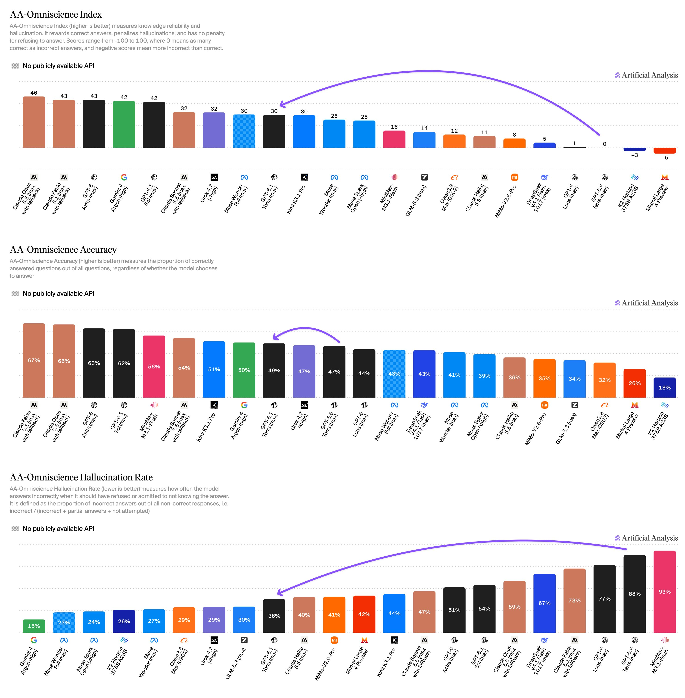
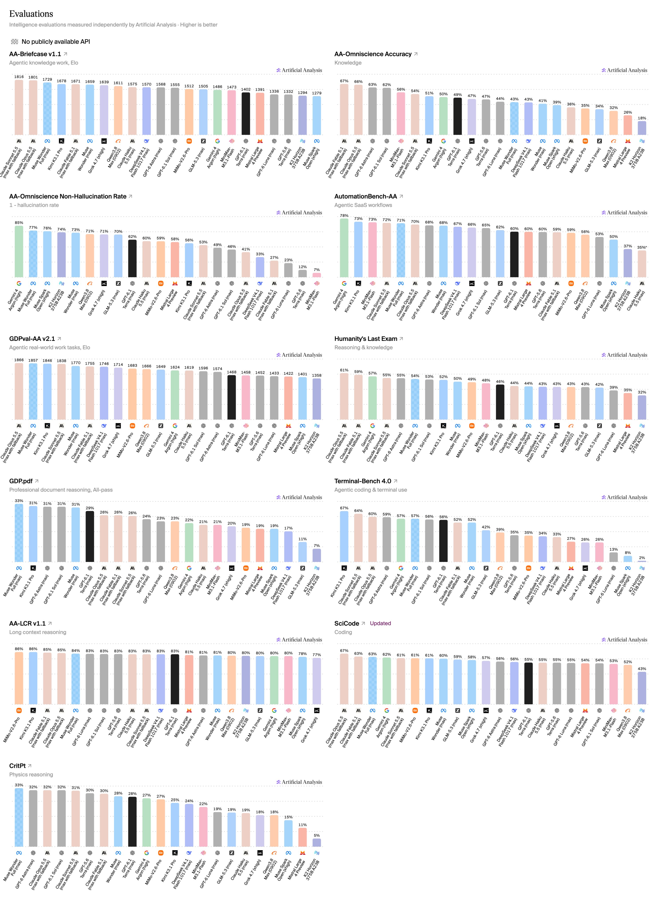

# Terra-Kostenvorteile hängen von Benchmark und Reasoning-Stufe ab

Artificial Analysis veröffentlicht am 26.10.2026 Drittmessungen zu `GPT-6.1 Terra`. Modellpreis, allgemeiner Intelligence Index und Coding-Agent-Leistung werden getrennt betrachtet; die Werte wurden hier nicht reproduziert.

## Preise und getrennte Messungen

Je Million Tokens nennt die Quelle `1 USD` Input, `5 USD` Output, `1,25 USD` Cache-Schreiben und `0,05 USD` Cache-Lesen. Für `GPT-5.6 Terra` nennt sie entsprechend `2/12/2,50/0,20 USD`.

Die folgenden Vergleichswerte gelten für `max`, soweit angegeben:

| Messung | `6.1 Terra` | `5.6 Terra` |
|---|---:|---:|
| Intelligence Index `v4.3.2` | 48 | 42 |
| Intelligence-Kosten/Task | `0,40 USD` | `1,40 USD` |
| Omniscience Index | 30 | 0 |
| Omniscience Accuracy | 49 % | 47 % |
| Omniscience Halluzinationsrate | 38 % | 88 % |
| Terminal-Bench `4.0` | 55,6 % | 35,4 % |

Im Coding Agent Index `v2.0` erreicht `Codex/Terra max` ebenfalls 48 Punkte; `Sol max` erreicht 54, `Luna max` 31. Die kosteneffizienten Terra-Stufen sind dort `low/xhigh`, im Intelligence Index dagegen `low/medium`.

Die Einzelübersicht zeigt für `Terra max`: Briefcase `v1.1` 1402 Elo, GDPval `v2.1` 1468 Elo, AutomationBench 60 %, HLE 46 %, GDP.pdf 24 %, LCR `v1.1` 83 %, SciCode 55 % und CritPt 28 %.

## Einordnung

Die Halluzinationsrate bezieht sich auf nicht korrekt beantwortete Aufgaben, nicht sämtliche Antworten. Dieselbe Punktzahl in zwei Indizes bedeutet keine identische Fähigkeit; Harness, Index-Version und Aufwand gehören zum Vergleich. Eigene Aufgaben können andere Effizienzgrenzen haben.

## Kernaussagen

- Modell und Reasoning-Stufe getrennt anhand passender Messungen wählen → [[Modell-Eskalation-von-guenstig-nach-teuer]].

## Verbindungen

- [[Modell-Eskalation-von-guenstig-nach-teuer]]
- [[2026-10-23-artificialanlys-2113688083145314416]]
